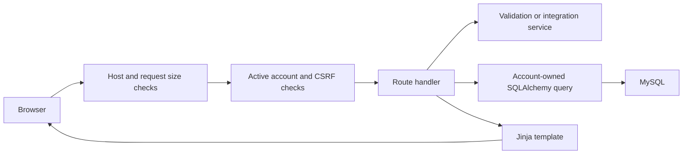

# Architecture

Sugar Watch is a server-rendered FastAPI application with SQLAlchemy and MySQL.
The `app` package contains runtime code and browser resources. Root-level
`main.py` and `migrations.py` preserve existing operational commands.

```text
app/
  core/          Configuration, sessions, CSRF and import authentication
  db/            SQLAlchemy sessions, models and recorded migrations
  forms/         Allowlisted fields, validation and safe error responses
  routes/        HTTP handlers and account-owned queries
  services/      Libre, USDA, Apple Health and nutrition logic
  utils/         UTC timestamps, display units and pagination
  templates/     Jinja pages and shared navigation
  static/        JavaScript and CSS served locally
scripts/         Development, setup, sync and release commands
tests/           Isolated checks and separate operational checks
deploy/          Example configuration and service/update templates
docs/            Public development and deployment references
```

## Requests and account ownership



Routes should stay focused on HTTP concerns and owned-record queries. Service
modules hold reusable parsing and calculations. Database sessions use context
managers; multi-record imports validate a full request before committing.

## Configuration and resources

`app/core/settings.py` loads the root `.env` and validates production settings.
`PROJECT_ROOT` locates configuration; `BASE_DIR` points to the `app` resource
directory. Templates and static files therefore work independently of the
shell's current directory. Provider credentials stay server-side.

## Storage and migrations

`app/db/session.py` owns the SQLAlchemy engine, session factory, and declarative
base. `app/db/models.py` declares the tables and constraints. Startup creates
missing tables and applies recorded migrations in `app/db/migrations/`.
Migrations preserve existing records and record completion in `schema_migrations`.
MySQL schema changes can commit independently; application rollback does not
automatically reverse a migration.

## Integrations

- LibreView imports validate an entire CSV and identify repeated device readings.
- LibreLinkUp collection runs separately from web requests, reuses private session
  state, and persists rate-limit cooldowns between scheduled runs.
- FoodData Central search uses a server-side API key. Signed reviews bind a food
  selection to one account before it can be saved.
- Apple Health uploads use a revocable hashed bearer token for one POST endpoint.
  Browser session cookies alone cannot authorize that upload. iPhone-exporter
  permissions and background execution control when data becomes available.

Glucose and health timestamps are stored in UTC. Browser code displays local
time. Measurement conversion and nutrient units are explicit, and meal entries
retain a nutrition snapshot so later food edits do not rewrite history.

## Development boundaries

The release checker runs separate processes with fictional credentials and
temporary SQLite databases. Operational MySQL and backup checks are intentionally
separate. Release bundles contain source and checksums, excluding private
configuration, exports, databases, caches, and `docs/private/`.

## Food discovery

Food search combines name and optional brand terms, with common/branded filters.
Restaurant terms can match non-branded USDA records. Barcode search validates
UPC/EAN/GTIN check digits and only displays exact GTIN matches, allowing zero
padding. Scanning uses a pinned local ZXing browser bundle, releases the camera
on stop/navigation/background, and sends only the decoded number to the server.
The same signed food-review flow is used for both search methods. No schema
change or additional provider key is required. HTTPS and camera permission are
required for scanning; typed barcodes remain available without a camera.

## Free Apple Health workflow

Native Apple Health ZIP imports use bounded disk spooling and streamed XML,
with one database transaction for full-file validation. Shared health-record
persistence handles source identity, account ownership, and repeat imports.
Shortcuts plans and batches use hashed bearer authentication on exact POST
paths. Per-category checkpoints and batch receipts support interrupted delivery.
No phone history is purged and no shortcut is presented as signed or installable
without an Apple-device signing step. Workouts use native exports because the
built-in Shortcuts recipe does not provide a complete workout-history reader.
